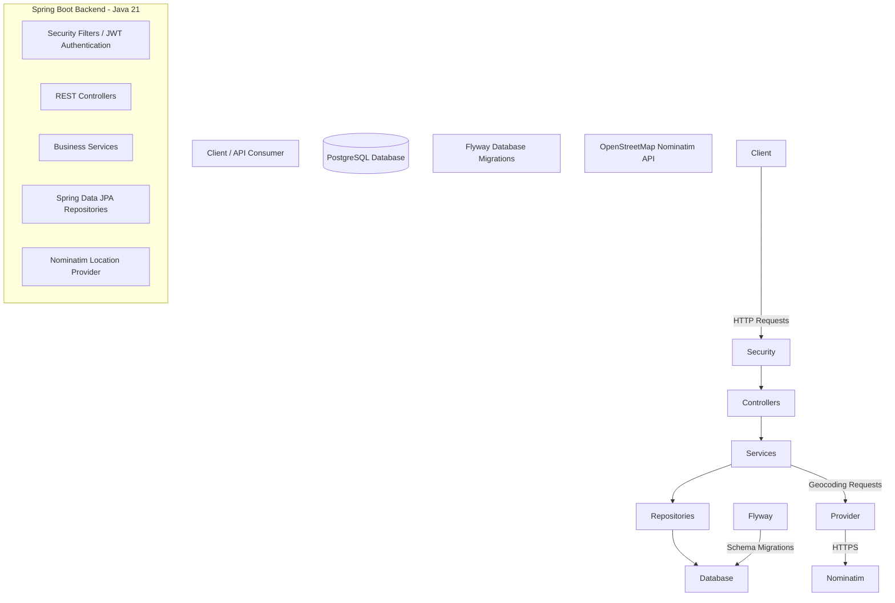

# Qaryati Architecture Diagram

## System Architecture

## Main Components

### REST Controllers

Handle incoming HTTP requests and return API responses.

- AuthController

- VillageController

- VillageNameController

- PopulationRecordController

- HistoricalEventController

- LandmarkController

- VillageAttributeController

- GeocodingController

### Service Layer

Contains business logic, validation, and coordination between components.

### Repository Layer

Uses Spring Data JPA to access PostgreSQL entities.

### Security

Uses Spring Security and JWT authentication, including request filters and role-based authorization.

### Database

PostgreSQL stores users, governorates, villages, village names, population records, historical events, landmarks, and village attributes.

Flyway manages database schema migrations.

### External Geocoding

Nominatim provides location lookup through the LocationProvider interface.

The geocoding implementation includes HTTP timeouts and request rate limiting.

## Architecture Notes

- The application follows a layered architecture.

- Controllers handle HTTP communication.

- Services implement business logic.

- Repositories manage database access.

- PostgreSQL provides persistent storage.

- JWT protects authenticated API operations.

- External geocoding is isolated behind a provider interface.

