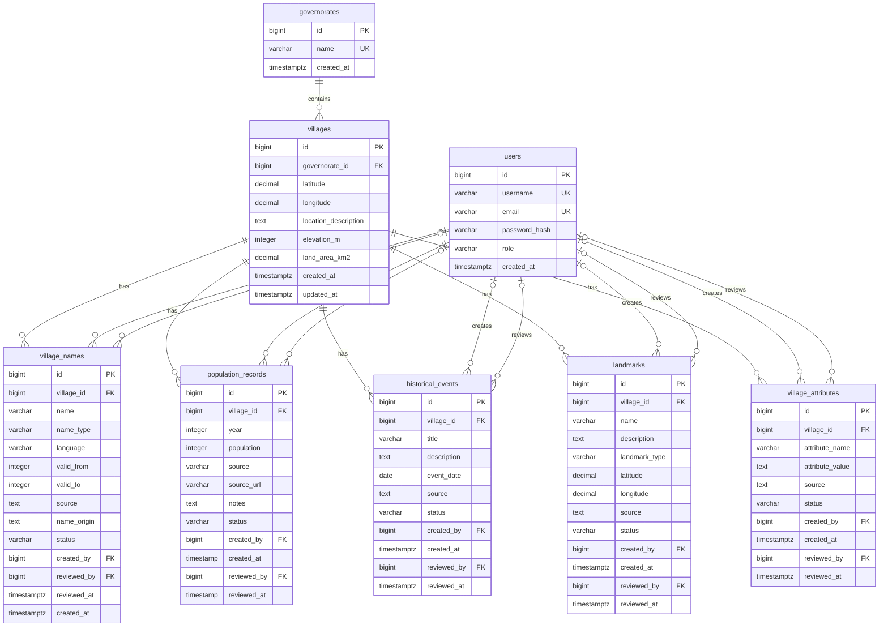

# Qaryati Database ERD

## Notes

- Based on Flyway migrations V1 through V6.

- PK means Primary Key, FK means Foreign Key, UK means Unique Key.

- Village names, historical events, landmarks, and village attributes are deleted automatically when their village is deleted.

- Population records reference villages without an ON DELETE CASCADE rule.

- The population_records table has a unique constraint on village_id, year, and source.

- created_by and reviewed_by reference users.id.

- Optional user relationships reflect nullable foreign keys.
